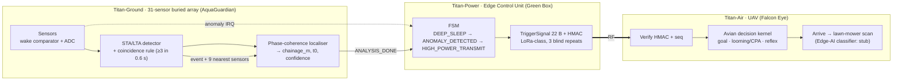

# Titan-Edge — Architecture Document (Digital Twin v0.1)

Status: **simulation-validated, no hardware in the loop.** Every number below is produced by `titan_edge_core_sim.py` (`benchmark_log.txt`, `benchmark_results.json`). Electrical and flight-power constants are engineering assumptions, listed in the `Assumptions` dataclass.

## 1. Data flow and event logic

Event sequence (all times relative to the physical event, seed 7):

| t | Event |
|---|---|
| +17.5 ms | first sensor trigger (propagation + STA/LTA) |
| +19.5 ms | `ANOMALY_IRQ` → ANOMALY_DETECTED (2 ms wake) |
| +0.82 s | gather window closes (waits for neighbouring sensors) |
| +1.15 s | localisation done (host compute ≈ 0.3 s) → HIGH_POWER_TRANSMIT |
| +1.35 s | first TriggerSignal received by UAV, HMAC verified |
| +5.4 s | UAV airborne (4 s assumed spin-up) |
| +95 s | UAV arrives (1.5 km) · +154 s area scanned |

## 2. Module contracts

| Module | Input | Output | Code |
|---|---|---|---|
| MOD 1 Sensing | 31 × 16 000-sample records @ 2 kHz | `DetectionReport{chainage_m, t0_s, delta_t_s, confidence, n_sensors_used}` | `SubSurfaceArray`, `sta_lta_detect`, `phase_coherence_localize` |
| MOD 2 Power/Edge | `PEvent` (ANOMALY_IRQ, ANALYSIS_DONE, FALSE_ALARM, TX_COMPLETE) | state, energy ledger per state, `TriggerSignal` bytes | `PowerFSM`, `TRANSITIONS`, `TriggerSignal` |
| MOD 3 Air | `TriggerSignal` | flight metrics, clearance, scan coverage | `AvianKernel`, `fly` |

**Phase-coherence metric.** For candidate position *x*, each sensor's spectrum is multiplied by `exp(+j2πf·|xᵢ−x|/c)`. At the true source the residual phases agree across sensors at every frequency; the score is the energy-weighted mean resultant length of the unit phasors (phase only, so attenuation is irrelevant). Coarse 4 m scan, then 0.25 m refinement; origin time from the delay-and-sum envelope peak. A 50 Hz notch (identical on all channels) removes pump hum.

## 3. FSM

| From | Event | To | Draw (assumed) |
|---|---|---|---|
| DEEP_SLEEP | ANOMALY_IRQ | ANOMALY_DETECTED | 18 µA while asleep |
| ANOMALY_DETECTED | ANALYSIS_DONE | HIGH_POWER_TRANSMIT | 25 mA |
| ANOMALY_DETECTED | FALSE_ALARM | DEEP_SLEEP | |
| HIGH_POWER_TRANSMIT | TX_COMPLETE | DEEP_SLEEP | 120 mA |

Any other (state, event) pair raises — the table is the exact structure a FreeRTOS port would encode, with events delivered by `xTaskNotifyFromISR` / a queue to the scheduler task.

## 4. Wire protocol — `TriggerSignal` (22 bytes, little-endian)

| Off | Type | Field |
|---|---|---|
| 0 | u8 | magic `0xE7` |
| 1 | u8 | version |
| 2 | u16 | node_id |
| 4 | u16 | seq (monotonic, replay rejection) |
| 6 | u8 | severity |
| 7 | u8 | flags |
| 8 | f32 | chainage_m |
| 12 | i32 | dt_us (detection lag vs. estimated origin) |
| 16 | u8 | confidence (0–255) |
| 17 | u8 | reserved |
| 18 | u8[4] | HMAC-SHA256 tag, truncated |

LoRa SF9 / 125 kHz airtime 205.8 ms; sent 3× (50 ms spacing); the UAV acts on the first valid copy. The demo key in the code is a placeholder; a 32-bit tag and no key rotation are demo-grade, not production security.

## 5. Mapping to the uploaded repositories

| Layer | Existing evidence reused | What this twin adds / what it does *not* claim |
|---|---|---|
| Ground — AquaGuardian | Reflex/decision philosophy; its own README states TRL 3 and that its CTOWN source-localisation research gave *mostly negative* results | MOD 1 is a new, idealised 1-D pipe model. It is **not** validated on branched networks |
| Power — Green Box | `firmware/` reflex kernel + safety supervisor compile and pass desktop tests (`greenbox_reflex_desktop_test.log`: 0 false fires in 200 normal steps, first fault fire at step 253); int8 v4 model bit-exact vs TFLite | FreeRTOS/ADC/RPMsg glue still scaffolded; reflex thresholds are placeholders (its own test surfaces a stale torque baseline). Green Box today targets Cortex-M7 + A53, not a bare M-class node |
| Air — Falcon Eye | Slack-priority triage + reflex fast-path concept; sim-validated collision awareness (2 400 Monte Carlo trials) | Falcon Eye is an aircraft collision-awareness prototype. The UAV kernel here is new; **no "AvianOS" exists in the uploaded code** |

## 6. Known limitations

1. 1-D homogeneous pipe, single source, Gaussian + 50 Hz hum noise; no multipath, junctions, or traffic noise.
2. Localisation degrades sharply at low SNR (see §B of the log: median 19 m at 6 dB, no detection at 0 dB).
3. Dispatch latency is dominated by the 0.8 s gather window plus 0.3 s of host compute, not by the radio. Instant ("zero-latency") response is not supported by this model; "≈1.3 s event-to-UAV-command, ≈5 s airborne" is.
4. Compute time is measured on a desktop CPU; the embedded port is unmeasured.
5. UAV is a 2-D point-mass with an accel limit; the Edge-AI scan classifier is a stub.
6. Energy results follow directly from assumed currents — treat as a model, not a measurement. Battery life is capped by assumed cell shelf life.
